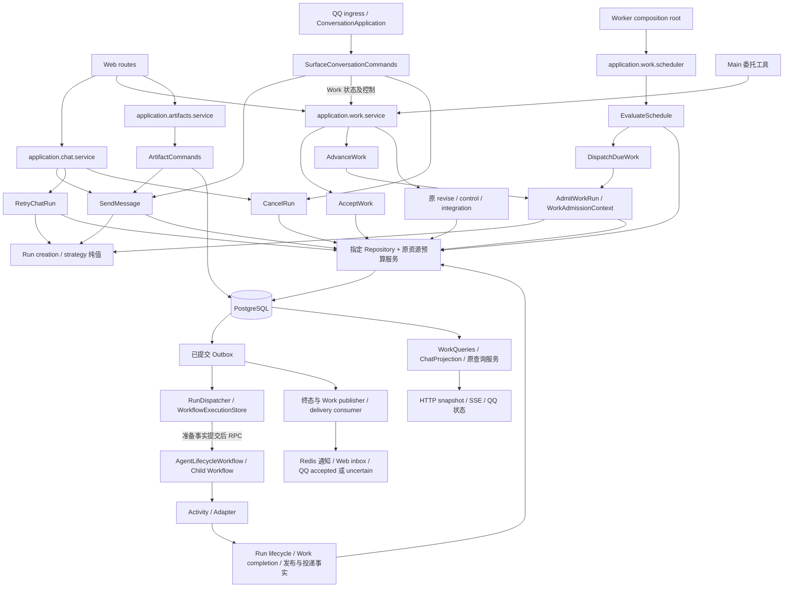
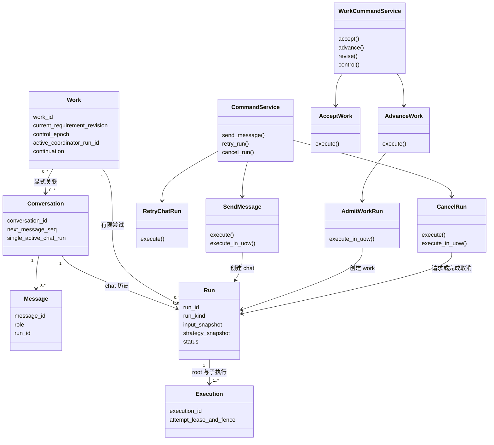
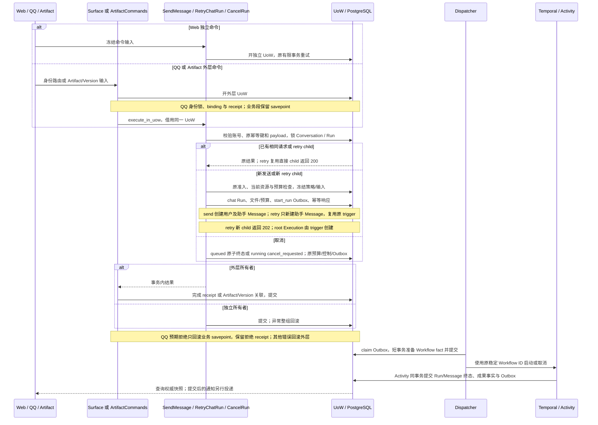
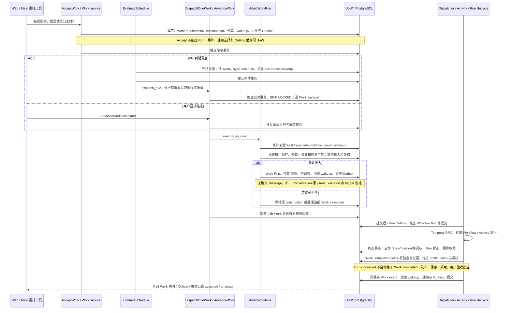

# 执行、状态与恢复

本文维护跨领域的状态权威和执行约束；具体委托与文件规则见 [Work](work.md) 和 [Workspace](workspace.md)，能力实现见[能力边界](capabilities.md)。

QQ 聊天 Run 在模型重试耗尽、最终以 `model_read_timeout` 失败时，同一终态事务入队固定超时通知；通知通过原渠道路由和现有 Delivery 回执流程发送，以 Run ID 去重。Run 与聊天 Message 仍保持失败，不生成成功答案或保留成功回复记忆。文案来自 `config/prompts/system.yaml` 的 `qq_model_timeout_reply`，Worker 启动时加载，留空关闭；入队后文案冻结，不随配置变化。Web、Work 和其他失败码不触发该通知。

超时通知不阻断失败事实：入队时原 QQ 绑定失效，仅回滚通知的保存点，Run、失败 Message 和终态 Outbox 仍正常提交；其他数据库或数据完整性错误继续报错，不被吞掉。入队后撤销绑定，Delivery 仍在发送前检查当前授权并取消投递。

## 状态权威

| 存储 | 负责什么 |
| --- | --- |
| PostgreSQL | Account/Identity/entitlement、Conversation/Message、Work/requirement/checkpoint/调度、Run/Execution/transcript/operation/receipt/lease/fence、预算/容量、文件元数据/授权/版本/保留、Research/Artifact、Trace、通知/投递/决议及 Outbox。必须一致的转换同事务提交。 |
| Redis | 短期 Event Context、通知、工具与运行时缓存。丢失不改变已提交业务事实，订阅恢复依赖权威查询。 |
| Hindsight | 长期语义 Memory Bank 与检索索引；应用 PG 保存来源、治理动作、撤权与上下文失效事实，不复制语义索引。 |
| TenantFileStore | 不可变文件字节；所有权、入口、版本、授权和 GC 引用仍在 PG。多个入口可引用同一 file_id。 |
| Git | 明确代码任务的账号级代码资源；普通文件流程和执行身份不依赖 Git。 |

注册事务把邀请码 entitlement profile 复制到 account_entitlements，并记录来源；后续权限以 account_entitlements 为准，修改邀请不追改账号。账号日额度使用 UTC 日账本，与累计 Work 和 Run 预算独立；revision、重试和 Subagent 不重置 Work 账本。

Run succeeded 只说明有限执行成功；Work completed 需要当前 revision 的证据。Message/Artifact 的 completed、发布、保存、版本采用、通知 accepted、已读和用户验收分别处理。Work Run 没有聊天 Message。业务执行不使用 Session 身份；浏览器认证 session/cookie 仍有效。

## HTTP 应用边界

[app.py](../../src/web_api/app.py) 只创建应用并装配协议层、错误映射和业务 Router。[lifespan.py](../../src/web_api/lifespan.py) 用 AsyncExitStack 持有 PG 连接池、可选 Redis、终态发布器和仅测试使用的 Fake 执行器；资源取得后立即登记释放，启动失败同样逆序回收。

[dependencies.py](../../src/web_api/dependencies.py) 统一认证、CSRF、幂等键与文件能力依赖；每次从 request.app 取所属应用的配置与服务，不使用全局应用状态。[middleware.py](../../src/web_api/middleware.py) 执行请求类型、body 大小与公共响应头协议；[error_handlers.py](../../src/web_api/error_handlers.py) 统一映射 HTTP/领域异常，不承担业务事务。

[routes](../../src/web_api/routes/) 按 health、auth、conversations、works、files、runs、artifacts 分组。路由负责参数、权限依赖、服务调用及 HTTP 投影；业务事务继续由命令服务持有，查询、SSE Gateway、文件发布与权限规则不迁入 Router。完整 HTTP 契约见 [API 参考](../reference/api.md)。

## 命令到终态

1. Web/QQ 把身份与输入转为统一命令。聊天在同一事务写 Message、Run、幂等事实和 start_run Outbox；Conversation 单 active 限制仅作用于聊天。
2. Work 命令提交不可变 requirement、checkpoint、continuation、预算与 wakeup。admission 在 Work 锁下校验 revision/control epoch、协调权、预算、资源及容量，冻结输入和策略，创建无聊天 Message 的 Run/root Execution。
3. Dispatcher 使用稳定 hpagent-web-run-{run_id} 启动 AgentLifecycleWorkflow。reminder 直接入队通知；research_report 由父适配器登记 invocation 并等待 ResearchCapabilityWorkflow，再执行父侧保存/验收；artifact_html 构建成果；chat_agent/work_agent 启动 AgentRunWorkflow（ReAct 或 Plan-and-Execute），子 Workflow ID 为 hpagent-agent-run-{run_id}。
4. Activity 提交 operation/receipt、输出和通用 Run 终态 succeeded/failed/cancelled。聊天投影、WorkCompletionPolicy 与通知分别依据持久事实推进。
5. Work 成功后的 ready continuation 在终态事务去重创建下一 wakeup；等待、blocked、暂停、停止和完成不忙循环。投递独立处理已提交通知，不因渠道失败重新执行 Agent。

Chat 的 [SendMessage](../../src/application/chat/send_message.py) 和 [RetryChatRun](../../src/application/chat/retry_run.py) 持有独立入口的 UoW；[CancelRun](../../src/application/run/cancel_run.py) 同时支持 Chat/Work attempt。事务内入口不提交、不另开连接或重试外层命令。[QQ 外层命令](../../src/application/surfaces/conversation.py) 保留拒绝回执所需的 savepoint；[Artifact 写命令](../../src/application/artifacts/commands.py) 在自己的同一 UoW 写 Artifact/Version 并借用 SendMessage 创建 HTML Run。应用先冻结 Chat/Work 创建记录，再分别调用 RunRepository.insert_chat/insert_work；root Execution 仍由数据库 trigger 唯一创建。

Repository 始终借用调用方 UoW，不持有数据库入口或提交权。`UnitOfWork(outer_uow)` 仍复用连接及原 savepoint，内层退出不代表独立提交；QQ拒绝回执和调度逐Work失败隔离继续使用原边界。Work 事件由应用明确协调 append、通知和 Outbox，尾部失败会整组回滚。

[OutboxService](../../src/web_domain/outbox.py) 和 [PostgresWorkflowExecutionStore](../../src/web_domain/workflow_execution.py) 保留原短事务所有权，SQL 分别委派 OutboxRepository 与 WorkflowExecutionRepository。准备 scheduled/current fact 提交后，Dispatcher 才调用 Temporal RPC；远端 terminal fact 不代替业务 Run 终态。StartDecision、Workflow ID 和分发/协调 Protocol 位于现有纯 [run_lifecycle_contracts.py](../../src/orchestration/run_lifecycle_contracts.py)，旧 dispatcher/reconciler 导出仍兼容，不改名称、队列或历史输入。

新 Agent Run 在创建事务的 `input_snapshot.agent_policy` 固定轮次、时区与工具摘要参数，
状态、root Execution 与 Outbox 仍同事务提交。相同 Run 的 Activity retry/接管复用原策略；
显式 retry 或 Work advance 创建新 Run 时按新 admission 冻结。历史缺失策略保持旧路径，
不补写、不改 History，非法或未知快照不回退当前配置。当前账号、授权、revision 和 fence
仍实时检查。策略来源及旧版本限制见[配置参考](../reference/configuration.md#持久策略来源与生效规则)。

所有非确定性 I/O，包括间接导入引出的数据库/模型/工具/文件/网络访问，都放 Activity/Adapter。Workflow 只编排、等待和调用 Activity/Child Workflow。Composition Root 拥有共享 Resource Pool、Sandbox、Brain、Action Runtime、Redis、MCP、Hindsight；可变上下文按 Execution 隔离。

Chat Context 使用对话历史、记忆与授权资料；Work Context 使用冻结需求、checkpoint、输入和候选，不加载关联聊天全文。Generic Work root 可一次委派最多三个只读子 Execution，费用仍属同 Run/Work；串行 plan steps 沿用当前 Execution，不等同并行 Subagent。

复杂调用持久事实使用迁移 060：`capability_invocations` 是不可变描述，caller Operation 是调用生命周期权威，capability Execution 是生产者生命周期权威，`capability_results` 保存专业语义 outcome。三者不互相推断终态。`capability_observations` 关联 caller transcript 与生产 Operation；结果已提交而观察缺失时，CapabilityInvocationWorkflow 复用原有子 Execution，补关闭后重新取得父 segment，并在同一事务中完成 caller Operation、配对 tool_result 与观察关联。capability 与只读 subagent 使用不同角色；两类子执行均受长期资源写入保护，Run 取消/终态会收敛活动子执行并使其 fence 失效。

## 进程与调度

[worker.py](../../src/orchestration/worker.py) 持有进程启动/关闭顺序：先构造共享依赖，再连接 Temporal、启动 Worker 与渠道监听；退出先停 ingress/producer，再退出 Worker，最后关闭共享资源。初始化失败也释放已取得资源。

[worker_dependencies.py](../../src/bootstrap/worker_dependencies.py) 构造基础设施与共享/QQ 服务，并将 AsyncExitStack 所有权交给进程；[durable_runtime.py](../../src/bootstrap/durable_runtime.py) 只组装 Activity、Worker、Dispatcher、Reconciler 和可选 Memory Retention，不启动后台任务。[worker_tasks.py](../../src/orchestration/worker_tasks.py) 集中持有后台任务和 readiness；[memory_schedules.py](../../src/orchestration/memory_schedules.py) 移除旧 Reflect Schedule，仅配置指标 Schedule。

执行上下文由 [execution_context.py](../../src/run_domain/execution_context.py) 传播，校验规则在 [execution.py](../../src/run_domain/execution.py)，分支事实在 [delegation.py](../../src/run_domain/delegation.py)，operation 完成与生产回执在 [results.py](../../src/run_domain/results.py)。这些规则不依赖 Temporal/Activity，接收调用方 UoW，不另开事务。Activity 仍负责心跳、取消和 Temporal 错误转换；Run 终态、Work 推进及通知继续由原事务统一提交。

普通调用和工具调用共用 `results.begin_operation`；同一 Operation 在同一 fence 内重入复用注册的生产 attempt，换 fence 才登记新 attempt。普通入口遇到 `intent_recorded/uncertain` 拒绝执行，工具入口保留原 payload 交给既有副作用对账。`complete_operation` 自行复验当前 fence 与已有回执 digest/disposition，冲突不能静默跳过；专业 Activity 不应复制这套进入、回执和提交逻辑。迟到接收同时检查 Execution 状态、注册 attempt 与 Work 协调资格；过期结果只保留原生产事实，不能成为当前推进证据。

主 Worker 同时组装 Lifecycle/Agent Worker、Dispatcher 和 PostgreSQL Work due loop。due loop 维护 schedule desired/applied version、occurrence 与 wakeup；容量等待后重新校验。Memory 指标使用 Temporal Schedule；旧全 Bank Reflect Schedule 在启动时移除，归纳由 Hindsight 原生 Consolidation 负责。

Document Workflow 在生命周期队列编排，重型规范化 Activity 在独立 document Worker 执行；稳定 operation 保存结果，不创建另一套 Work/文件状态。队列和注册入口见 [Temporal](../reference/temporal.md)。

退出时先停止 ingress/后台 producer，再退出 Worker，最后逆序关闭共享资源。健康探针检查 schema、Temporal、Lifecycle/Agent Worker 与 Dispatcher；API ready 不能替代 Worker 或真实模型链检查。

## 模型请求与费用

请求顺序：entitlement/tier → Provider serializer 校验 transcript 与 tool-call/result 配对 → 冻结 Model Input Snapshot → 单独事务原子预留 Account/day、Work（若有）、Run → composition 发送前检查 → 记录 dispatch 并分发冻结请求体 → 结算/释放。Anthropic 的独立 system 也计费；工具结果以明确 observation 进入下一轮。快照存在不等于已发送，查询时按当前 entitlement 投影可见字段。

发送前检查可读取包含完整工具 schema 和上下文的冻结请求；拒绝时不登记 dispatch、不开始 HTTP，释放业务预留。发送前失败或取消释放预留；已发送但结果未知按估算结算，避免无主 hold。Snapshot、Trace 与账本各有用途，不能互相代替用量事实。

dispatch 登记事务重新校验 Execution fence、Snapshot 的账号/Run/Execution 归属及当前 entitlement 版本，异步预检之后的撤权或版本变化也须拒绝。同一 Snapshot 只能取得一次发送资格；重复登记拒绝发送，也不能释放原生产者仍持有的预算。`settled/released` 预留不再授权另一条 HTTP 请求；正常模型重试仍使用既有 execution_attempt/fallback 身份并单独计费，不能把此冲突改判外部写入成功。

模型预留先取得既有账号/Work/Run 权威锁，再取得 Account/day 与预算锁，与终态恢复保持同一锁序。发送登记和发送前释放在同一 Account/day 账本锁下复验预留与 dispatch：先释放则不得发送，先取得发送资格则不得释放。尚未取得发送资格的重复调用者失败或取消，不清理原生产者的 hold。历史未填 execution_id 的 Snapshot 只按同 Run 的 root 映射核对，不改写原冻结记录，也不允许映射到子 Execution。

绑定同一 Snapshot 的预留跨 UTC 午夜重试时仍复用原 quota_date，不在新日期再占 Account 额度。当前 entitlement/tier 仍重新校验；原快照、Run/Work 预算和已经结算的用量不改写。独立的新模型 attempt 继续按其自己的请求日期占额。

Run 终态事务通过 `ModelBudgetCoordinator.recover_terminal_in_uow` 处理绑定该 Run Snapshot 的遗留模型预留：无 dispatch 释放，有 dispatch 按原预留估算结算，Account UTC 原日期、Work 与 Run 同事务收敛。dispatch 仅证明请求可能已发送，不证明有响应；原 measured/provider 结算不改写。终态重入可补收敛旧 hold，重复执行不再计费；结算失败则终态事务一同回滚。该处理不决议工具或渠道的未知外部副作用。

随后 `RunBudgetService.recover_terminal_in_uow` 沿原 Work/Run 账本，把仍无可靠实测结算的工具、专业阶段等预留按原量记为 estimated。已结算或释放的不变；预算结算既不完成 Operation，也不决议未知外部效果。因此费用可收敛而 Work 仍保持 pausing/stopping，直到原回执或显式决议足以解除 blocker。

终态估算结算后，重复相同金额和 usage_source 的结算只作幂等重放；迟到的不同实测金额或
measured/provider 来源不能覆盖已结算记录，返回预算冲突。当前没有自动补差或账目重开机制。

普通工具在预留预算前读取本 Run 的冻结 Agent 策略；读取失败或取消时不派发工具，
不为尚未执行的调用遗留预留或估算用量。派发后的未知结果仍按既有结算与副作用对账边界处理。

这些收敛不更改 Workflow 命令图、输入 schema、稳定 Operation ID 或冻结描述，也不修改已应用迁移。旧 History 沿已记录 Activity 结果重放；恢复中的 Activity 仍须满足当前授权与 fence。历史回执不重编号、不改写，旧冻结请求不追随当前配置。

model_request_invalid、model_response_invalid、model_access_denied、model_request_rejected、model_rate_limited 当前不可自动重试；model_connection_failed、model_read_timeout、model_http_error、model_unavailable 当前可重试。HTTP 429 当前不可自动重试。分类贯穿 Activity、Lifecycle、Run DTO 和重试命令；普通模型故障不归为外部写入结果不确定。独立 Artifact 请求默认 read 90 秒、connect 最多 5 秒；常规聊天依 endpoint timeout。

## 并发、幂等与恢复

- 状态与分发意图同事务提交；Dispatcher lease 允许接管。command key、稳定 Workflow ID、operation/effect key 和生产回执约束重复副作用。未知响应恢复原意图，不换键冒充新请求。
- Work 协调权、Execution attempt/segment lease 与 fencing、显式资源锁、跨进程 capacity_queue/capacity_turns 是四项独立约束。新 token 拒绝旧写入，账户并非全执行独占。
- operation attempt 记录原生产者；旧 attempt/revision 的迟到回执可保留事实，但不得追加当前 transcript、写新 Workspace 结果或完成新需求。
- Approval/wait 持久化后等待 Signal，segment 释放租约；恢复重新获 attempt/fence。Worker 缓存淘汰只销毁内存协程，不在 Workflow 循环外提交结束等待命令；重放恢复仍读取原持久 wait。正常完成、到期与取消继续提交结束等待 Activity。Work revise/pause/stop 提交 control epoch 与取消意图，Run 取消和 Work 控制分别收敛。
- sending lease 失效的外部投递转 uncertain，显式 resolution 后再决定接受/重发。未知外部写入保留 pausing/stopping blocker，不能提前报告停止。
- Run 固定候选不提供永久授权；select/read/save 仍核对当前 grant、revision 与 fence。attempt scratch 隔离，旧清理不能删除新目录。
- PostgreSQL 持久 wait、ready wakeup、once catch-up/daily latest 与容量续租不依赖进程内 timer；SSE/Redis 仅通知恢复，不裁定完成。

## Research 阶段 lease 与恢复

主 Agent store 注入 agent_execution_lease_ttl_seconds（默认 900 秒）。ResearchActivities 独立持有默认 30 秒 lease 的 store，按 invocation 的子 Execution 取得各阶段 segment；获得阶段 segment 后，每 5 秒校验并续租 PG 所有权，再发送 Temporal 心跳。等待其他 segment 时仅发送等待心跳，不延长对方 lease。

续租失败会停止当前阶段并清理后台任务；失效 lease 不能被续活，旧线程的持久写入仍由 fencing 拒绝。Worker 崩溃后，新 attempt 等待旧 lease 自然到期，再以新 token 接管；阶段 operation 与不可变输出发布按 invocation 固定，父保存意图仍按顶层 Run 固定；重试复用原标识。publish/save 的 Activity 窗口为 start-to-close 60 秒、schedule-to-close 120 秒，端到端恢复还受 Temporal 重试、排队和依赖可用性影响，30 秒 lease 不是完成时间承诺。

隔离恢复测试使用实际默认 lease：长阶段跨越初始到期时间仍拒绝抢占；发布或保存提交后 SIGKILL 原 Worker，由替代 Worker 恢复，并校验历史基线、保存意图与结果去重。测试不清 lease、不强制接管，也不缩短默认值。

真实 Provider、生产 Worker、QQ 外发与恢复演练使用实际网络/配置分别验证；隔离或协议测试通过不能替代这些结论。诊断入口见[故障排查](../operations/troubleshooting.md)和[测试指南](../development/testing.md)。

复杂能力通过 [CapabilityInvocationWorkflow](../../src/agent_workflows/capability.py) 在同 Run 的独立 Execution 内运行；父登记和父观察是分离的短 segment，中间等待不持父 lease。子结果、父观察和 Run/Work 终态是独立事实；固定身份恢复、调用上限与取消约束见[能力边界](capabilities.md#通用持久调用与-harness)。

长期记忆上下文使用 `run_executions.memory_context` 和 Snapshot 上的无正文 manifest。
失效提交与模型 dispatch 使用账户锁排序，但按实际读取 scope 的交集拒绝。
执行 fence 和 Run 成功提交检查同一规则，迟到模型结果、工具、子执行及 final/fallback
不能复用被撤回上下文；历史助手消息在组装时复验依赖。缺失旧 manifest 或所需失效历史时
保守拒绝相应记忆上下文。原 Snapshot 保留审计，不能改写并重用旧请求。

## 业务主干调用图

组合根直接引用 [Chat service](../../src/application/chat/service.py)、[Work service](../../src/application/work/service.py)、[Artifact service](../../src/application/artifacts/service.py) 与 [Scheduler](../../src/application/work/scheduler.py)。旧模块只导出相同类，未复制实现。下面画出业务主干从入口到 PG 和提交后执行的路径；节点中的调用是职责关系，事务划分以下方时序和所有权表为准。

## Chat、Work、Run 核心关系

下图是现有持久化概念与应用协作者关系；Conversation、Work、Run 节点表示业务记录，不表示新增 ORM 类。一个关联 Conversation 不授予 Work 聊天全文或文件权限。

## Chat 时序与事务

QQ 在本图只表示 send/cancel；其 work_* 状态、关联与控制经 WorkCommandService(uow) 执行并保留外层 receipt，见下方所有权表。Retry 只有独立命令入口。Artifact 创建时先准备自己的 Artifact/Version，再在同一 UoW 借用发送用例；图中的借用调用表示此业务段。Retry 使用原锁顺序和当前准入，HTML retry 保留原 executor 与冻结输入。单活跃槽仍由 Chat 路径及 PG 约束共同保证。时序表示完整主要分支，具体失败码及 SQL 顺序以用例源码为准。

## Work 时序与事务

## UnitOfWork 所有权

| 边界 | UoW 所有者 | 事务内借用者与提交点 |
| --- | --- | --- |
| Web send/retry/cancel | SendMessage / RetryChatRun / CancelRun 的 execute | 依赖、projection、资源预算和 Repo 借用；整个命令成功退出后提交，原有限重试包围命令 |
| QQ ingress | SurfaceConversationCommands | send/cancel 调用公开 execute_in_uow，原 savepoint 隔离拒绝；work_* 通过 WorkCommandService(uow) 查询/关联/控制，复用连接及嵌套 savepoint；receipt 由外层提交 |
| Artifact 创建/新版本 | ArtifactCommands | Artifact/Version 与 SendMessage.execute_in_uow 同外层提交；legacy 预算有效值不变 |
| Work 接受/推进 | AcceptWork / AdvanceWork | dependencies、AdmitWorkRun、资源预算、record_work_event 借用；不增加独立 commit |
| Work 修订/控制/关联 | application/work/service.py 中的原方法及 integration_command | 原锁、事务与命令重试保持；窄仓储不取得提交权 |
| Work 调度 | EvaluateSchedule；随后 DispatchDueWork | 两个连续但独立的事务；dispatch 批次内逐 Work savepoint；不把评估与准入合并 |
| 资源撤权 | ResourcePolicy 的原命令事务 | CancelRun.execute_in_uow 只借用；其异常仍回滚撤权事务 |
| Run 终态 | 原 Run lifecycle / WebRunLifecycleService | completion/progress、预算恢复、Execution 收敛、事件和通知借用原同一 UoW |
| Outbox / Workflow 技术事实 | OutboxService / PostgresWorkflowExecutionStore | Repo 只执行 SQL；每个原短事务退出后才进行 Temporal RPC；远端状态不直接当业务终态 |
| 查询 | WorkQueries、原查询服务 | 自己开读 UoW；snapshot_in_uow 借用已有事务，避免在命令中另开连接 |

UnitOfWork 实现未改变：DSN 或 pool 入口拥有连接与提交；UnitOfWork(outer_uow) 复用连接并建 savepoint，内层退出不提交外层。异常回滚与释放、deadlock/serialization 的有限重试策略保持。锁顺序、当前授权、revision/fence、数据库时钟和幂等键仍属于具体业务流程的显式约束，不能通过统一 Repo 方法或嵌套对象省略。

## 当前限制与待核验风险

以下是需要在后续行为变更或可靠性验收中单独处理的边界，结构整理没有消除这些限制。

| 范围 | 当前事实与验证限制 |
| --- | --- |
| 独立 Artifact 预算 | `legacy_artifact_sender` 显式保留 observe、file-p0-v1 和原预算默认值，与 Web 配置注入可能不同。不能把结构迁移理解为已统一 enforce 策略。 |
| Outbox 租约 | ack/retry/dead 按 event/status/locked_by 判断，没有 claim generation。同 worker_id 被复用时旧消费者可能影响新租约，这是待复现的 ABA 风险，尚不能据此认定已丢数据。 |
| Dispatcher 日志 | mark_processed 返回 false 后仍可能记录 processed；日志不证明该次 CAS 已接受，应查询 PG 权威事实。 |
| dead-letter 适用范围 | OutboxService.dead_letter 先锁关联 Run，不能直接泛化到 run_id 为空的 Work aggregate；Work 发布失败继续使用原 retry 路径。 |
| Terminal publisher 监督 | recover/claim 的整轮异常未在循环外自行捕获，可能结束后台任务；是否由更高层恢复需要单独核验，不承诺全部消费者无限自愈。 |

这些风险的复现、claim token/Schema 设计、预算策略统一及任务监督变更应分别定义合同与测试。现有单元、隔离PG或sandbox通过不代表真实Temporal恢复、Provider/QQ外发、非空历史库升级、压力或PG断电恢复已验收。具体选测与环境依赖见[测试指南](../development/testing.md#业务命令与持久化选测)。
