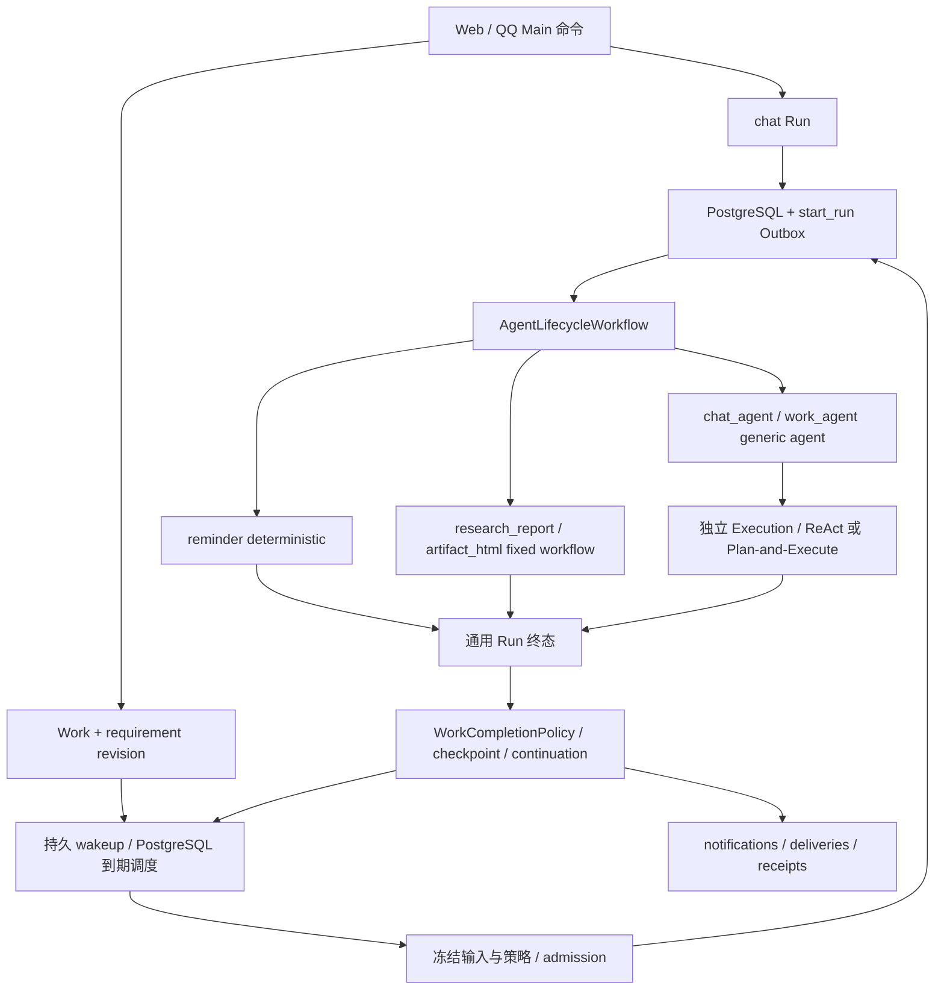

# Work：持续委托与有限执行

本文描述当前Work与执行契约；模块入口见[代码地图](../reference/repository-layout.md)，验证方式见[测试指南](../development/testing.md)。

## 主体与执行身份

| 对象 | 职责与边界 |
| --- | --- |
| Account | 跨 Web / QQ 的所有权、模型访问、日额度和容量主体。 |
| Main Agent / Conversation | 理解当前交互、创建或调整 Work；保留聊天顺序与同对话单 active chat Run。 |
| Work | 持续委托；保存当前 requirement revision、checkpoint、continuation、control epoch 和协调 Run 指针。 |
| Run | 有限执行事实；保存冻结输入、策略版本、预算、执行结果和终态。Work Run 的 Conversation / trigger Message 为空；当前所有 Run 的 session_id 为空。 |
| Execution | Run 内独立的 root 或 Subagent 上下文；有自己的 transcript、segment、attempt lease、fencing token 和 operation。 |
| Artifact / Workspace | 成果版本与长期资源。生成、发布、保存、采用分别记录，不能以某一项冒充全部完成。 |
| Notification / Delivery | 不可变通知与每个目标的投递状态；渠道接受、用户读取和用户验收是不同事实。 |

Work 生命周期为 `active / pausing / paused / stopping / stopped / completed`；continuation 为 `ready / at_time / awaiting_input / awaiting_delivery / retry_after / blocked / none`。Run 终态为 `succeeded / failed / cancelled`；Message 和 Artifact Version 使用各自的 `completed` 状态，不能混用。

Work 的需求 revision 不可变。修订、暂停、停止和推进是带幂等键、版本检查与审计的命令。关联 Conversation 不导入聊天全文、附件或文件权限；后台执行不占聊天 admission，也不伪造 user / assistant Message。

Generic Work 可在 Requirement 中设置 `deliverables={schema_version:1,items:[{id,format,required,output_criterion_id,format_criterion_id}]}`。format 为 markdown/docx；每个目标绑定独立的纯 output_exists 与 check_passed criterion，required 必须一致，最多十个目标。未指定时保留旧契约。格式从 Main 的工具 schema、需求持久化、Run 冻结简报传到 Worker，工具执行检查所选格式，最终验收校验准确证据。Web「修改要求」可选择 Markdown、Word 或同时交付；未修改格式时保留完整原目标与其他条件，修改产生正常 revision 并使旧执行失效。

数据库迁移 072 仅为历史需求增加可空 deliverables，不回写历史记录或 hash；新增冻结输入校验、交付目标校验与完成提交约束。每个必需目标的存在性和指定 verifier/version 的格式通过证据必须指向同一 ResultRef；不同目标不能共用该引用，不能拿 A 文件存在与 B 文件格式合并验收。Python completion policy 与数据库提交均执行配对检查，其他必需条件和原完成触发器继续独立生效。

当前限制：Main 的 `accept_work` 工具 schema 只将 objective、capability_key、spec 列为 Requirement 必填项，仍可能接受 `acceptance_criteria=[]`、`deliverables=null` 的 Generic Work。提示词要求不能替代创建前的正式约束；真实模型即使看到了格式 schema，也可能省略这两个字段。此时文件发布可以成功，但没有可绑定的 criterion，服务端不会凭空登记 output_exists 或格式证据，也不会完成 Work。Tool-first 的真实委托成功与完整交付验收仍需分别核对；收紧该创建契约是尚未完成的后续工作，不能用放宽证据或完成策略替代。

## 统一有限执行链

Main 对明确后台/离页后继续的请求先登记 Work 并返回提交身份，不以聊天中的 HTML 或口头承诺代替；保存权限可以在接受后通过正常资源命令授予。Main 接受必需保存的 Generic Work 时校验存在 required 的 `workspace_saved` 验收条件，缺失时在幂等命令认领前拒绝不可能满足的请求。轻量后台搜索与文字整理默认使用 `generic_work` / ReAct，以 required 的 `output_exists` 条件验收；来源与排除要求放在 objective/constraints，generic spec 只接受 schema_version/reasoning_mode。普通文字不默认要求 HTML、专业研究、长期保存或用户验收。Main 的 `accept_work` 使用原始用户消息与稳定 mandate_slot 生成幂等键，重试前读取已提交委托回执。工具描述提供 Requirement 结构；组合目标使用 generic_work，有限即时 HTML 请求留在 Chat。普通问答不修改 Work，进度查询只读；明确修改走完整 Requirement 的 revise 命令，控制走 pause/resume/stop。已完成或停止的目标后续修改创建新委托。

Work 快照的 `sources` 保存 `{conversation_id, source_message_id}`，来自既有 work_conversations 的组合归属；无来源的关联返回 null 消息，不制造锚点。只提供 source_message_id 时，接受命令从账户内真实消息推导会话。来源投影不复制文件授权。Web 来源消息展示权威快照任务卡片，任务详情可返回准确消息；Chat 与任务控制互不替代。

### Generic 成果发布与 Workspace 保存

普通 Markdown 的生成、发布、下载以 `output_exists` 验收，不默认要求保存到 Workspace。Main 的 `accept_work / revise_work` 使用默认 false 的 `workspace_save_requested`：只有用户明确要求保存，或明确保留已有保存约束时才设为 true。false 却带必需保存条件的新命令被拒绝；该标志只是 Main 写入校验，不是授权，不扩展持久 Requirement schema。直接 API/任务编辑器的完整 Requirement 仍代表显式要求。

明确要求保存但未选目录时，保留必需的 `workspace_saved`，设置 `deliverable_policy.required=false` 并省略目标 ID；这表示等待补充，不表示取消保存条件。新建/修订 Generic 拒绝全零 UUID 占位目标及缺少必需保存验收项的必需保存策略，HTTP 为不可重试的 `422 workspace_save_invalid`；检查位于已提交幂等回执重放之后。

接受、修订、继续和 Run admission 检查当前账户内真实目录/文件目标及 Work 自己的 `create_child`（更新已有入口为 `update_content`）授权。未确定、不可用或缺少权限时为 `awaiting_input`，reason 分别为 `workspace_save_destination_required / workspace_save_destination_unavailable / workspace_save_permission_required`；旧要求缺少必需保存验收项时为 `workspace_save_criteria_required`。不创建 Run、Execution、执行租约或模型预算预留。单个 criterion 的 evidence_types 是备选关系，混合 `output_exists / workspace_saved` 不会凭空变成强制保存。

选择/修正目标通过正常 If-Match 修订创建新 revision；授予目录权限必须走显式 Work 资源命令，聊天授权与目录元数据均不复制为 Work 授权。授权命令仅重新评估这类保存前置条件等待；满足后按原计划创建去重 wakeup，暂停、其他输入等待、预算/进展保护和未决副作用不会借此解除。直接资源授权后也可显式 advance，准入再次检查。资源冻结不代替实际保存时的当前 grant、revision、lease/fence 校验；权限可能在运行中撤销，原保存与完成校验保持不变。

旧 Requirement、失败 Run、完成回执和账本不改写。旧的空/占位/失效目标在下一次准入进入等待，而不是继续产生付费执行；已运行 attempt 不被此准入检查回溯取消，仍受原 fence 和当前权限约束。错误的历史保存要求须由用户审阅后通过新 revision 明确修正；不自动删除验收项、不自动重跑或提额。原命令重放仍返回原回执，等待变化通过权威查询读取。

### Generic 旧验收条件的显式升级

网页新建 `generic_work` 使用必需的 `output_exists` 条件；Generic 最终回执只接受 `output_exists / check_passed / workspace_saved` 的服务器证据。成功工具调用的 `operation_receipt` 不证明已发布成果。新建和修订命令拒绝写入带此旧类型的 Generic 要求，HTTP 返回不可重试的 `422 generic_acceptance_revision_required`。验证放在原命令幂等对账之后：历史已提交请求重放仍返回原回执，不悄悄转换 payload。

已有要求与完成回执保持不可变，不批量改写、不重置账本、不把旧成功操作视为新成果。旧任务可继续读取；在任务编辑器中逐项审阅条件后，明确确认将 `operation_receipt` 改为 `output_exists`，再提交带原 If-Match / 幂等键的新 revision。转换保留 criterion ID、required 标记及其他类型，混合列表去重。确认绑定到当前编辑基线，新基线需要重新确认。修订仍走正常取消/收敛、revision/epoch、权限与验收链；暂停状态保留，失败 Run 与历史要求保留，completed/stopped 不提供此修订入口。完成仍须新 revision 的准确成果证据，必需保存与检查不会被删除。

运维可在明确选定的业务库中以只读事务审计当前受影响的要求（只输出按状态汇总的数量，不输出目标正文）：

```sql
BEGIN READ ONLY;
SELECT w.status, count(DISTINCT w.work_id) AS affected_works
FROM hpagent.works w JOIN hpagent.work_requirements q
  ON q.account_id=w.account_id AND q.work_id=w.work_id
  AND q.revision=w.current_requirement_revision
CROSS JOIN LATERAL jsonb_array_elements(q.acceptance_criteria) c
WHERE q.capability_key='generic_work' AND c->'evidence_types' ? 'operation_receipt'
GROUP BY w.status;
COMMIT;
```

不直接 UPDATE 旧 requirement/status，也不通过 advance 或新 Run 绕过旧条件。账户所有者通过上述显式修订恢复可执行契约；已完成/停止任务保留历史，后续工作另建委托。此修复不新增 Schema Migration。共享契约夹具为 `test/fixtures/work/generic_completion.json`，由网页 builder、后端命令/HTTP 回归和生产文字闭环测试共同使用。



`StrategyRegistry` 选择服务端注册的 `strategy_kind / executor_key / executor_version / strategy_policy_version`，admission 固定在 Run 与 root manifest 中。没有注册的能力或版本直接拒绝，不退回无约束 Agent。

| capability | strategy_kind / executor_key | 行为 |
| --- | --- | --- |
| 聊天 | `generic_agent / chat_agent` | Main 上下文与 Work 管理工具。 |
| `reminder` | `deterministic / reminder` | 持久通知入队；不调用模型，不创建 Git / 文件 / Sandbox。Run 成功后 Work 可继续等待投递回执。 |
| `research_report` | `fixed_workflow / research_report` | 父适配器调用同一局部 Research 能力；按 Markdown/基础检查事实验收，并承担必需保存。阅读视图失败不否定研究。 |
| `generic_work` | `generic_agent / work_agent` | Work brief + ReAct / Plan-and-Execute，不加载 Main 聊天全文或管理工具。 |
| `artifact_build` | `fixed_workflow / artifact_html` | 显式 Artifact-build Work 通过共享 HTML 能力执行；Artifact API 默认创建有限 Chat Run。每个生产 Run 自负模型成本。 |

所有外部 I/O 都在 Activity 中执行。Workflow 只编排和等待；通用资源准备使用 Execution attempt 隔离的 scratch，Git 仅在明确需要代码资源时使用。

## 调度、执行权与完成

`work_schedules / work_schedule_occurrences / work_wakeups` 是 PostgreSQL 持久调度事实，由主 Worker 的 due loop 检查。Work 不创建 Temporal Schedule；`applied_version` 表示 PostgreSQL evaluator 已安装当前配置。Memory 指标继续使用 Temporal Schedule；旧全 Bank Reflect Schedule 已停用，归纳由 Hindsight 原生 Consolidation 完成，详见[记忆边界](capabilities.md#memory)。

支持 immediate、带时区 offset 的 once 和 IANA 时区 daily。once 采用 catch-up；daily 历史漏触发合并为最新 occurrence，保留 `missed_from`。DST 重叠取 first fold，缺失本地时间跳过当日。旧 schedule version / requirement callback 记录跳过，不启动新 Run。

接受新 Work 或修改其 timing 时，命令边界要求 once 的 `due_at` 严格晚于服务端当前时间。
过去或恰好当前的时间返回 `work_time_in_past`，HTTP 422，包含 `due_at` 和 `server_now`；
事务回滚，不创建 Work、唤醒或占用幂等键，收到明确拒绝后可修正参数重新提交。响应未知时仍须
复用原幂等键和 payload 查询事实。已提交命令优先幂等回放，不因重试时过期而拒绝；只改内容、
保留原 timing 的修订不重新校验过去时间，已接受任务的恢复、恢复控制和漏触发仍沿 catch-up。
模型按注入的消息时间、执行基准和默认时区解释自然语言；明确过去日期须先询问是否现在执行，
不得擅自加一年或变成立即执行。动态时间校验不放在不可变 Requirement 的反序列化校验中。

Work 协调权由 `active_coordinator_run_id + requirement_revision + control_epoch` 决定；它与 Execution attempt lease、显式 Git 资源锁和跨进程容量票据分别校验。迟到旧 attempt 回执保留原来源，不得写当前 transcript、Workspace 或完成新 revision。暂停/停止有未知外部结果时保持收敛中，不能提前宣告停止。

显式重试沿同Work、同requirement revision下最新失败/取消Run建立父链；尝试先后按单调递增的control epoch判断，避免数据库时钟回拨改变父链。成功后的继续执行与新调度occurrence建立新的执行链。

`WorkCompletionPolicy` 使用本 revision 的持久证据推进状态：成功 operation receipt、研究报告、精确 Artifact Version、必需 Workspace 保存、渠道回执和显式用户验收。Generic Work 的文字回复仅是候选；没有有效完成证据时进入等待输入。ongoing 委托不因一轮成功就完成。成功后的 ready continuation 在终态事务中创建去重 wakeup；等待输入、blocked、暂停、停止和完成不会自动续跑。

## 有界推进与静默通知

迁移 069–070 增加 `work_progress / work_progress_samples / work_progress_facts` 与 `work_daily_results / work_daily_result_refs`。保护按 Account、Work、requirement revision 持久化，Run 更换、定时触发和 Activity 重试均不清零。policy v1 首次计数时冻结阈值，重复失败和无进展默认各三次，任一达到即 `blocked/repeated_failure` 或 `blocked/no_progress`；配置见[配置参考](../reference/configuration.md)。

只有服务器注册的复杂能力调用进入窗口，Atomic Tool 不逐个计数。生产结果与样本同事务提交；同 invocation 只计一次。未提交局部结果的基础设施失败在当前 Run 失败事务中补样本；失败类别可从关联的 CapabilityResult 或 Run failure_code 查询。重复失败身份由能力、契约版本、规范化输入和错误类别组成，不保存模型摘要作为身份。cancelled、uncertain 和明确 requires_input 不进入异常窗口。

有效进展来自 ready 文件/已提交 Artifact 的内容 hash，以及绑定同一内容与 verifier/version 的通过检查；Research 使用结构化 claims 和来源 URI/hash 的规范化快照，忽略生产者、claim/evidence 随机 ID 和展示文本。重复成果换引用 ID、改写摘要或 checkpoint 文字不产生进展；新有效事实重置未触发的无进展窗口。有有效成果/检查事实的正常 daily 无变化结果清零无进展计数；只有成功摘要而没有有效事实仍计入保护。定时唤醒本身不清零。已触发的保护保持到显式干预：修改需求形成新 revision；明确暂停后继续在原 revision 记录恢复并清零计数，已见事实和历史样本保留。补资料本身不扩大当前 Run 的冻结输入，也不自动解除保护。

保护阻止新的复杂调用及新 Run admission；Harness 先提交父观察，再以持久保护原因终止后续决策，无需额外模型调用决定停止。旧 attempt/revision/control epoch 不得更新新窗口。预算失败仍为独立 `blocked/budget_exhausted`：advance、定时、新 revision 和暂停/继续不能清除，实际显式增额后才重新评估准入；相同额度重放不解除阻塞，增额也不清除独立的进展保护。Account/day、Work、Run 费用账本不变，uncertain 的对账门禁优先于自动推进。

daily Run admission 固定 `input_snapshot.daily_baseline_run_id`。仅当前协调资格下成功结束的 Run，并且局部结果均成功、检查通过、有有效成果，才能提交新的固定比较基线；父保存/验收事务失败、insufficient、Run 失败和迟到结果都不推进基线。每次记录精确 ResultRef 保留关系，不授予读取基线正文的权限；Research 历史仍须符合冻结候选与当前 read_content grant，并限定到本轮固定基线。policy v1 把 Research 结构化事实变化、其他能力有效输出内容/通过检查变化视为重要变化，不做 LLM 自述重要性判断。无变化是正常成功，等待下一 occurrence，ongoing 委托不因这一轮成功结束。明确的周期提醒仍按每个 occurrence 履约，不把提醒文案相同当作无变化研究结果。

所有 Work event 和 Outbox 继续同事务保存并供 SSE 恢复；通知不再逐条复制 accepted、advanced、run_succeeded 等内部事件。只通知完成、暂停/停止、需要输入或处理的阻塞、投递异常及重要 daily 变化。相同终态重放不重复入队；需要渠道回执的成果沿原 fulfillment 通知，不再额外发送变化通知，无变化轮次不创建新的 fulfillment。投递重试仅消费原通知，不能重跑生产业务；暂停/停止/修订会取消尚未发送的变化通知，发送前继续检查可信目标与当前有效性。消息入队、渠道 accepted、已读和用户验收仍为独立事实。

Work 查询补充 `progress`（策略/阈值/计数/原因）与 `daily_baseline`（准确 Run、前一 Run、changed），没有记录时为 null。界面显示无进展/重复失败原因，隐藏直接 advance；用户可修改要求或显式暂停后继续。预算不足仍使用增额入口。

## 资源、费用与上下文

Work 有显式 `work_input_refs`，权限以 `subject_kind=work` 管理；聊天采用 Conversation grant。Run admission 冻结候选与输入引用，使用前检查当前权限。Chat 和 Work brief 展示候选第一页最多 20 条元数据及分页指引，文件正文须 select / read；运行中新增资料在下一 Run 生效。

模型发送顺序是 entitlement / tier → 规范化并校验 Provider 请求 → 冻结 Model Input Snapshot → Account UTC 日额度、累计 Work（若有）、Run 原子预留 → 真实分发 → 结算或释放。Anthropic 独立 system 字段仍计入预算。快照存在不证明请求已发出。

新 revision、Run 重试、fallback 和 Subagent 都不重置 Work 累计预算。预算调整是显式版本化命令。`CapacityService` 用 PostgreSQL 票据限制 coordinator / model / tool / fetch 并发，轮转账户并为交互保留容量；等待不占物理执行票据。具体默认值见[配置](../reference/configuration.md)。

## 成果与投递

Artifact Version 保存 producing Run / Execution / operation；Work adoption 记录精确版本和 requirement revision，不改写原生产者。生成版本、采用版本、Workspace 保存、用户验收和渠道接受分别记账。HTML 可在上下文 Artifact Inspector 下载；当前手工长期保存按文本源码上传，不扩大上传 MIME allowlist。

通用文字结果沿 `capability_acceptance_evidence → capability_result_refs → stored_files` 保留准确字节，原 GC 引用检查阻止回收。完成回执固定当前 revision 的证据；Work 查询的 `results` 从这份回执解析准确 ResultRef、生产 Run/revision、文件摘要及认证 content_url，完成通知携带相同 `results`。这些产品查询不授予 Agent 跨 Run 读取权限。任务「成果与执行」已有已发布文件下载入口，使用本人认证读取正文；不需要先保存到 Workspace。

Generic Work root 观察成功的 `text/v1` 发布时，若该调用只有一个 Markdown ResultRef，且当前冻结需求只有一个必需的纯 `output_exists` 条件，父侧复用原验收服务确定性登记该条件的证据，与观察及调用回执同事务提交。有 deliverables 时，可信格式 Check 将发布唯一映射到对应目标，复用原证据服务登记存在性与通过的格式证据；同格式多个目标有歧义时不猜测映射，需显式选择准确证据。未限定格式且多个输出条件有歧义时不自动映射；普通文件、其他能力、跨 Run 结果和未观察的发布不走此自动登记。多次发布保留各自不可变证据，最终按 criterion 补入最近可信观察的证据；模型已显式选择的同条件证据不覆盖。

最终结果漏列上述证据时可从可信观察记录补入。最终仅有叙述或伪工具调用文本时，只有持久证据满足全部必需条件、且没有必需保存策略，才提出 `deliverable_ready`，仍由原 completion policy 校验分支、进展保护、副作用、权限、revision 与终态事务。明确的 `progress_saved`、等待输入和等待时间不提升为完成；检查、Workspace 保存、用户验收和投递事实不由发布推断。

`notifications / delivery_targets / deliveries / delivery_decisions` 替代旧 QQ delivery 与提醒 intent 模型。聊天通知引用已完成 Message；Work 通知引用生产事件/operation。Web 接受是进入私有 inbox，QQ 接受是 Adapter 收到发送回执，两者都不是已读。外部 sending lease 失效转 uncertain，不自动重发；显式 resolution 记录已接受、未发送或重复风险决定。QQ 群目标只接受摘要，Main 群聊工具观察值也裁剪账户私有信息。

## 有限 Subagent

仅 Generic Work root 可执行一次不可变委派，最多三个并行分支、每分支最多两次尝试；禁止递归。分支只获得 parent 的当前授权资源子集和只读工具 manifest，有独立 Execution / transcript / attempt，费用记入同一 Run / Work。分支不能修改 Work、授权、长期文件或直接通知；root 验证结果后继续完成判断。串行 Plan-and-Execute steps 不等同 Subagent。

## 部署与验证边界

迁移 054–058 建立上述边界；054 / 055 / 057 有开发期空业务存储检查，没有 Task / Work 双写或历史回填。旧库切换见[部署](../operations/deployment.md)，禁止修改已应用迁移 checksum 来绕过门禁。

验证按[测试指南](../development/testing.md)选取领域、API、Temporal 与浏览器范围。真实模型完整工具往返、QQ 发信和持续压力需要独立验收；Research 阶段 lease 与恢复机制见[执行与恢复](execution.md)。

Generic Work 最终回执优先解析原始 JSON 对象；兼容带说明文字、且末尾只有一个 `json` 代码块的显式对象。普通叙述、多个代码块和 DSML 伪工具调用均不提供验收证据；可信观察的补证规则见上文。提取后仍按原契约校验全部字段、criterion、当前 revision/fence 与持久化 typed evidence，围栏本身不构成验收证据。

最终结果解释由 `work_domain.execution_result` 持有：`parse_generic_result` 只做纯解析、候选降级和大小/列表边界校验；`generic_result` 在调用方已有事务中核验 typed evidence、合并可信观察并提出完成建议。`WebRunLifecycleService.complete` 在原锁和当前操作回执校验后直接调用该领域函数，再以同一 UnitOfWork 推进 Run 与完成策略；结果解释不自行开事务或写入终态。`application.work_context` 只承担输入加载、来源路由与身份绑定，不参与结果验收。相关离线规则用例见 `test/test_work_execution_result.py`；真实事务与权限组合继续由 `test/work_domain/test_output_evidence.py` 等覆盖。
