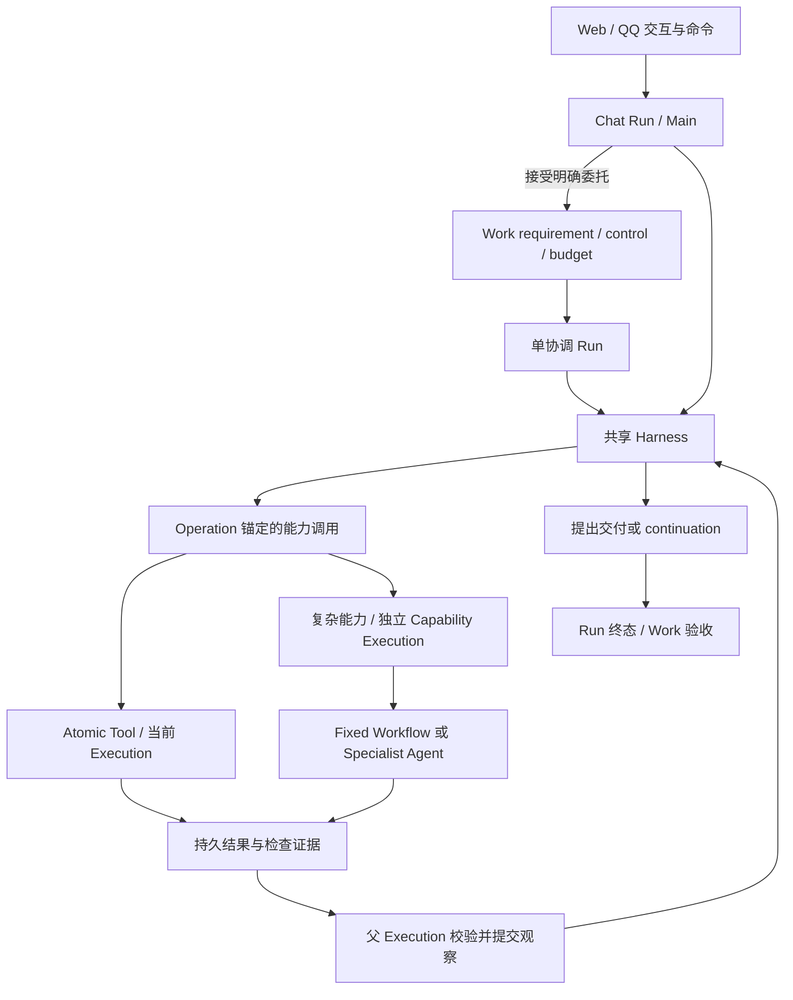

# 通用助手与可组合能力：目标架构提案

状态：S7 的待实施设计。S1 基础契约、S2 持久调用边界、S3 局部 Research 与 S4 HTML/成果采用 已归入[能力边界](../architecture/capabilities.md)、[执行与恢复](../architecture/execution.md)和[Workspace](../architecture/workspace.md)；S5 Main/任务/UI 接口见[Work](../architecture/work.md)与[Web 契约](../architecture/web-ui.md)，以源码和测试为准。S6 持续推进保护与静默通知已归入 [Work](../architecture/work.md#有界推进与静默通知)，实现存在不代表全部环境验收已通过。本文不授权清库、部署或真实外发。

设计基线：最新提交，依据用户提供的《HpAgent 通用 AI 助手平台》愿景、后续需求澄清及代码静态核查。实施前必须重新核对最新代码；S1 已固定的名称和字段以当前架构文档及源码为准，其余新入口仍是设计名称。

## 1. 产品目标与明确排除项

HpAgent 是面向普通用户、目标驱动的通用 AI 云助手。用户描述目标，Agent 在授权和预算内组合能力，观察真实结果、修正路径并交付可复用成果。Research、HTML 是首批专业能力，不是能力架构的上限。

已确认的产品要求：

- 保留 Web / QQ 统一业务底座；现有前端形态基本保留，仅补必要的任务、消息、控制与成果契约。
- 即时聊天不自动成为 Work。需要脱离当前交互继续履行的目标由 Work 承担；离页、断网不取消执行。
- 任务界面可查看、暂停、继续、停止和找回成果，并定位到来源 Chat Message。
- 执行中仍可聊天。普通消息不修改 Work；查询进度只读；明确补充或修改任务的指令走受控命令。
- 暂停后可继续；停止结束委托，成果保留；后续可基于成果创建新任务。
- Research 完成要求报告持久化与明确的基础检查通过，不要求用户已经满意；用户可继续微调。
- 无进展、预算不足、重复失败任一达到条件，停止无效推进；原因决定阻塞、等待或暂停，不统一永久停止 Work。
- 现有测试数据不要求保留，最终可以重建空库；仍保留完整迁移链、checksum 和回放 fixture。
- 展示深度来自真实组合、反馈修正、恢复与成果复用；以业务目标为先。

不属于本轮范围：

- 生成另一套包含真实登录和数据库的应用。此前对此存在误解；实际只是 HpAgent 自身已接域名、可公网访问。
- 生成应用的长期托管、数据库供应、凭据平台或公网部署能力。
- 前端重设计、任意 Agent 递归、跨 Work DAG、动态插件市场、任意事件自动化平台。
- 新建另一套预算、授权、调度、审计或 Workflow 引擎。
- 旧测试数据搬迁、线上热升级或长期双写兼容。

“幂等”和“保密”均作为工程约束，不以用户口述中的歧义扩展产品范围。任何破坏性环境切换在实际执行时指定目标，不由本提案推定。

## 2. 已核实的现状与约束

| 当前事实 | 代码依据 | 对设计的影响 |
| --- | --- | --- |
| ReAct 与 Plan-and-Execute 已有持久工具循环 | [Agent workflows](../../src/agent_workflows/)、[Activities](../../src/agent_activities/runtime.py) | 复用 Harness，不另造通用 Agent Runtime |
| StrategyRegistry 为顶层 Run 选 executor | [registry](../../src/orchestration/execution_strategy.py) | 不把它直接当作内部 Capability Registry |
| Main 有 Work 接受与控制工具 | [main_agent.py](../../src/application/main_agent.py) | 保留命令边界、mandate 幂等、群聊披露限制 |
| 同 Work 单 active Run；Work Run 无聊天 Message | [Work 契约](../architecture/work.md)、[迁移 054](../../persistence/migrations/054_durable_work_foundation.sql) | 不采用同 Work 并行 Child Run 主方案 |
| Subagent 限于 Generic Work root、一次委派、最多三只读分支 | [delegation](../../src/agent_activities/delegation.py)、[迁移 058](../../persistence/migrations/058_optional_subagents.sql) | 不能仅放开 prompt 就复用为通用写入子能力 |
| Research 阶段和报告以 invocation 为身份；父适配器完成 Run | [runtime](../../src/research_activities/runtime.py)、[persistence](../../src/research_domain/persistence.py) | 后续 HTML/采用复用局部结果与当前授权边界 |
| Research 已有 Markdown，报告 HTML 是确定性展示 | [research_workflow.py](../../src/orchestration/research_workflow.py) | 不误认为需要从零实现报告输出；展示失败不能否定研究结果 |
| HTML 请求创建有限 Chat Run，显式 Work 复用相同 HTML 能力 | [services](../../src/web_artifacts/services.py)、[build](../../src/web_artifacts/build.py) | 后续入口复用局部能力与父侧采用服务 |
| Artifact publisher 已有生产 Operation / Execution | [publisher](../../src/web_artifacts/publisher.py) | 复用发布内核，补输入与结果契约 |
| Operation / Receipt 支持 attempt、迟到结果与跨 Run effect 引用 | [results](../../src/run_domain/results.py) | Invocation 以 Operation 为锚点 |
| 工具完成和 transcript 事件可以同事务提交 | [store](../../src/agent_activities/store.py) | 保留可靠父观察提交，不用 Signal 裁定完成 |
| Generic 验收主要验证成功工具回执 | [work_context](../../src/application/work_context.py)、[completion](../../src/work_domain/completion.py) | 需增加具体结果和检查谓词，不能仅相信 tool_success |
| Document Router 启动稳定 Workflow 后在调用侧等待 | [routing](../../src/file_runtime/routing.py) | 不是完整的释放父 Activity 持久等待范式 |
| 工具注册依运行模式分支，文件与原生/MCP 不天然同时可用 | [sandbox_manager](../../src/sandbox/sandbox_manager.py) | 新能力注册不能依赖打开危险工具模式 |

这些是静态事实，不代表已通过本轮运行验证。当前事实文档不应在实现前改写为目标架构。

## 3. 主方案与责任边界



推荐决策：

1. Work 管理目标；Run 管理有限执行；Execution 管理执行上下文。保留单 Work 协调权。
2. Harness 是现有 Workflow、Activities、Context 和 Actions 的职责集合，不是新部署服务。
3. Atomic Tool 通常在调用方 Execution 内完成；需要隔离的复杂能力使用同 Run 下的 Capability Execution。
4. Child Workflow 是编排关系，不等于新 Run。复杂能力不拥有 Work 控制权，不直接完成父 Run。
5. CapabilityInvocation 以调用方 Operation 为逻辑身份，附加不可变描述和执行关联，不建立独立可写的调用状态机。
6. 默认子能力不脱离父 Run 存续。父执行终止时取消子执行；已持久化结果保留。Worker 重启属于恢复同一执行，不是独立存续。
7. Automation 复用 Work 的 ongoing 与现有调度，本轮仍支持已实现的 immediate / once / daily，不承诺任意事件触发。

替代方案与拒绝理由：

| 方案 | 优点 | 本轮处理 |
| --- | --- | --- |
| 全部在父 Execution 中运行 | 身份少 | 仅用于简单能力；复杂能力独立上下文与生产者需要隔离 |
| 同 Work Child Run | 可复用部分 Run 化专业代码 | 拒绝作为主方案；会改变单 active Run、协调、预算和验收边界 |
| 每次能力新 Work | 生命周期现成 | 拒绝；用户目标碎片化，难以统一干预和验收 |
| 独立能力 Job 平台 | 可脱离父执行、跨任务共享 | 延后，当前没有足够业务需求 |
| 新 Invocation 全生命周期状态机 | 查询直观 | 拒绝重复状态权威；允许描述表和派生投影 |

## 4. 能力定义与发现

新增逻辑 Capability Registry，与顶层 StrategyRegistry 分离；首期服务端静态注册，不允许运行中由模型注册实现。

每个 definition 至少包含：

| 字段 | 语义 |
| --- | --- |
| key / contract_version / implementation_version | 能力身份、输入输出契约与实现版本 |
| description / input_schema / output_schema | 模型可理解的能力、严格结构化输入和结果 |
| executor_kind | atomic / fixed_workflow / specialist_agent |
| execution_mode | inline / isolated_execution |
| allowed_surfaces / required_services | Chat / Work 可用性与运行依赖 |
| resource_operations / side_effect_policy | 允许申请的资源动作及副作用分类 |
| limits / retry_policy / cancellation_policy | 时间、调用、并发、重试及取消策略 |
| verifier_keys | 可以产生哪些检查证据，不能由模型任意声称 |

发现先按身份、当前授权、依赖和执行模式筛选，再做语义检索。执行时再次验证，发现成功不是授权凭证。对模型优先暴露有类型的能力函数，不要求它填写执行角色、fence 或预算主体。

已有 Atomic Tool 使用轻量适配，不为每次读取额外创建 Execution 或描述记录。Research / HTML 等复杂调用通过统一持久调用边界执行；注册不等于绕过权限。

首期复杂能力只允许 root 发起，默认串行；允许同一能力多次调用。现有只读调查分支保留边界，不顺带扩成任意递归。专业 Agent 可以使用获准原子工具，本轮不允许再递归创建复杂能力 Execution。后续扩大并行或深度需有真实场景和单独容量验证。

## 5. 调用事实、状态与持久恢复

### 5.1 推荐数据关系

以下是逻辑契约，不预先指定迁移编号；实施 S1 时确定准确 SQL 和兼容字段。

- 调用方 `execution_operations.operation_id` 同时作为 invocation ID。模型只能提出业务参数，身份由可信执行代码产生。
- 为复杂调用增加一对一不可变描述，建议名 `capability_invocations`：caller Operation、account/run/execution、capability 和版本、规范化输入/摘要、资源范围、限制、父 requirement revision/control epoch、初始子 Execution 关联。
- 子执行使用新的明确角色（建议 `capability`），不能冒用当前只读 `subagent`。创建时验证 parent、同 account/run 和调用描述。
- 子阶段各有 Operation，绑定子 Execution；子最终结果是已提交的生产 Operation 结果，并记录在子 Execution 的 result_ref。
- 调用描述不再存可独立更新的 succeeded/failed。父调用生命周期看 caller Operation；子执行生命周期看子 Execution；专业产物看其领域记录。
- 查询投影可显示 accepted / executing / waiting_approval / result_ready / observed / failed / cancelling / cancelled / uncertain，但必须说明来源，不能反向写入这些派生状态。

避免两个容易混淆的事实：子执行成功表示局部结果已提交；父 Operation 完成表示该结果已作为父观察可靠交付。二者不同，不是两份竞争的成功状态。

### 5.2 提交与执行流程

1. 父模型决策已持久化，固定 tool call 与 arguments ref。
2. 短事务验证当前权限、版本、父执行、预算可用性和调用限制，登记 caller Operation、不可变输入及子 Execution。相同身份不同输入拒绝。
3. 父 Workflow 根据登记结果启动稳定 ID 的 Child Workflow。Activity 结果丢失时先读取同一登记事实；不要换 ID。
4. 父不持有 segment lease、Workspace 锁或物理 model/tool/fetch 容量等待子 Workflow。Run 协调资格与有限时长仍有效，等待不无限延长 Run。
5. 子能力通过自己的 segment/attempt/fence 执行，并提交产物、检查及局部结果；不能完成父 Run。
6. 父获得新的 segment，按当前权限、revision、control epoch 读取子结果；在一个事务里完成 caller Operation 并追加配对的 tool_result。
7. Harness 基于 observation 决定继续、修正、等待或交付；只有领域边界能接受 Work 完成。

若 parent 已失效，保留原生产事实，不交付到新的 transcript 或推进新需求。后续 Run 只能通过显式结果采用复用。

### 5.3 故障与恢复矩阵

| 窗口 | 行为 |
| --- | --- |
| 登记提交、Activity 响应丢失 | 重读同一调用、子 Execution，不再次登记 |
| Child 启动响应丢失 | 同一稳定 Workflow 身份恢复，输入摘要必须一致 |
| 子阶段完成、后阶段失败 | 复用已确认阶段；结果是否可重用由能力契约决定 |
| 子结果提交、父观察未提交 | 只补父观察，不重做子能力 |
| 父观察提交、Workflow 响应丢失 | transcript/Operation 去重，继续后续决策 |
| 权限撤销、需求修订、暂停或停止 | 阻止新副作用；取消子执行；迟到结果仅归原生产者 |
| 外部动作已发出、结果未知 | uncertain，先 reconciliation 或显式决议，不自动重发 |
| 旧 attempt 迟到 | 原 attempt receipt 保留；不得覆盖新结果或借新 fence 提交 |

基建重试是同一调用；模型看到失败后提出重新执行是新调用。新调用不能借此逃避 Work 预算或重复外部动作的 effect 对账。按输入做缓存是独立优化，首期不做通用缓存。

审批等待复用持久 wait 和权威 probe，Signal 只唤醒。批准固定具体参数、目标及有效期，恢复时重查当前权限；不能把过期批准套用到新 revision 或变更参数。

对于长时间人工等待：Run 可在有限期限内持久等待；期限耗尽后保留业务待办并结束 Run，新的 Run 重新验证，不无限续命。复杂调用的取消必须等到子执行或未知副作用得到可确认处理，不能仅依据 Temporal cancel 请求报告已停止。

## 6. 权限、写入、预算和容量

有效授权 = 账户资格 ∩ Conversation/Work 当前授权 ∩ 父执行范围 ∩ 能力声明 ∩ 本次调用限制。

- Invocation 固定的是输入与权限上限，不是永久授权；读、模型发送前的资源使用、发布和保存均检查当前有效性。
- 子 Execution 可在自己的 scratch 中处理获准输入、产生不可变输出；不自动获得父执行所有工具或全部文件。
- 创建候选产物不等于长期保存。长期 entry 创建、版本覆盖、删除、通知、外部发布分别验证授权和 CAS。
- 默认子能力不直接修改长期 Workspace 或发送通知。父侧可信提交服务完成保存/采用；在父失效后不自动提交。
- 同 Run 新生成的结果通过明确的 invocation 结果关系向父授予受控读取，不扩大冻结的外部候选集合。兄弟能力只接收父显式传入的结果子集。
- ResultRef 不是 bearer token；读取必须解析归属和当前授权。来源文本、工具输出是数据，不得提升为系统指令或批准。
- 旧成果派生内容不自动全量写入 Memory。本轮避免把受限文件正文无边界保留；已有长期记忆的撤权政策不得宣称已解决。
- 默认不新增 Host Bash、网络或部署权限；保密性包括凭据隔离、群聊摘要披露和模型输入最小化。

费用保持 Account/day + Work（若有）+ Run 原子预留与结算，真实消费记一次，按 producing Execution / Operation 归属。调用级统计是投影；调用限制可作为额外上限，但不建立另一份费用账本，不父子重复计费。

能力 admission 的“预算尚有余量”不能替代每次模型/工具真实调用的原子预留。为最终观察和收尾保留可配置余量；余量不足时返回持久结构化结果，不依赖额外模型调用才能正确停止。

容量分开校验协调 Run、子 Execution 数量、模型/工具/抓取执行票据。复杂能力等待时父不占物理执行票据；子执行预算和容量不足要有界等待或返回阻塞，避免父占资源导致子永远无法启动。

## 7. ResultRef、验证与成果采用

建议统一逻辑结果外壳，专业 payload 保持有类型：

```text
CapabilityResult v1
  outcome: succeeded | insufficient | failed | cancelled | uncertain
  summary: bounded text
  outputs: typed immutable refs
  checks: verifier + version + subject_ref + verdict + evidence_ref
  gaps: bounded structured items
  error: code + safe_message + retry_class (optional)
  provenance: producing invocation / execution / operation
```

上述 outcome 是专业调用的语义结果，不能与 Execution/Run 状态直接等同。已正常完成的检查可以返回“不通过”；基础设施失败只有在安全、可验证地转换为观察时才返回父 Agent。授权失效、父取消和 uncertain 必须走相应控制路径。

ResultRef 至少包括 type、对象 ID、准确版本或不可变文件 ID、生产者关联；需要时有内容摘要/hash。支持 Markdown、Artifact Version、文件和检查证据，不强制所有结果成为 HTML Artifact，不新增第三份文件正文。

引用必须建立持久引用/保留关系，使 GC 能识别未交付调用、被采用结果和活动执行；仅有 JSON 中的字符串不够。摘要和正文走同一授权原则；长内容按引用读取，不全部塞入 Temporal History 或模型 transcript。

验收采用服务端注册的有类型谓词：

- `output_exists`：指定成果版本确实提交。
- `check_passed`：指定 verifier 对相同成果版本检查通过。
- `workspace_saved`：指定保存目标与版本操作确实提交。
- `user_accepted` / `delivery_accepted`：各自独立的可信回执。

具体字段在 S1 固定。模型可以提出 criterion 与证据对应关系，但不能定义任意可执行谓词、伪造检查结果或用无关成功工具回执满足质量条件。检查覆盖范围、失败与未检查必须可查询。

跨 Run 默认固定版本：用户选定成果 → admission/显式采用记录固定版本 → 当前授权检查 → 作为输入。执行中不追随“最新”。旧 producing Run/Execution 不改写，采用记录绑定当前 Work revision；停止/失败 Run 的有效部分成果也可以在检查后显式采用。

### 7.1 Research

Research 业务实例由 invocation 标识，stage、plan、report、source/evidence 和历史比较不能再依赖“每 Run 仅一个研究”。Run 仍用于归属、预算和查询关联。

局部成功契约：

1. Markdown 已作为不可变输出提交。
2. 来源和结构化 claim/evidence 已关联该研究实例。
3. 必需基础检查通过：非空/结构、引用身份与定位一致、无声明必需但缺失的输出；检查版本和范围可追溯。
4. 引用无效或必需检查不通过返回 insufficient，保留草稿与 gaps，允许父调整；来源较弱等非必需项可警告，不冒称事实全部验证。

确定性的报告阅读视图可以保留，但不决定 Research 成功。交互 HTML 是单独调用。Workspace 必需保存是父目标交付条件，不由 Research 完成整个 Work。

### 7.2 HTML

已实现契约见[HTML 与父侧成果采用](../architecture/capabilities.md#html-与父侧成果采用)。后续产品入口须保持准确 ResultRef/旧版本输入、父侧保存和 typed evidence 边界；当前基础检查不包含真实浏览器交互，不得描述为发现并修复了浏览器功能错误。

## 8. Chat、后台委托与干预

Main 仍使用现有共享 Harness。接受长期委托后快速返回已提交 Work 身份；Work Run 不占聊天槽、不创建伪造 Message。

使用既有 Work-Conversation 关联和接受命令的 source_message 作为来源锚点，必要时补充精确关联投影。前端在来源消息旁展示可更新的任务引用卡片，从权威 Work 查询状态；不不断改写已完成 assistant 文本。任务详情可定位来源消息；来源不可用时返回可用会话或任务本身，不伪造消息。

普通 Chat 执行也不因离页取消。任务中心可投影仍在运行的 chat Run，但不将它伪装成 Work：chat Run 提供查看/取消，持续委托才有 Work 暂停/继续。交互式 Chat 使用较短执行限制；预计需要持续后台执行时，Main 先接受 Work。

运行中转后台采用明确的委托边界：提交可用中间成果和 Work 输入引用，完成 Chat 返回；不让两个 root 同时执行同一副作用。不做任意时刻搬移完整 transcript/lease 的通用“Run 升级”。

消息处理：

| 用户意图 | 行为 |
| --- | --- |
| 普通问答 | 新 chat Run，不改变 Work |
| 查询进度 | 只读 Work 查询 |
| 改变目标/约束 | revise：新 requirement revision，取消旧协调执行，重新准入 |
| 增加执行所需资料 | 显式输入/授权命令；当前冻结输入不静默扩张，下一 Run 使用 |
| 暂停 | 收敛当前子执行并保留进展，随后 paused |
| 继续 | 新 Run 从 checkpoint 与合法结果引用继续，不恢复旧 fence |
| 停止 | 收敛取消和未知副作用后 stopped，禁止自动再调度 |
| 对已完成成果提出新修改 | 默认新关联 Work/Chat 调用，输入固定旧成果版本；不永久重开所有完成 Work |

指代不明确才澄清。明确低风险委托可直接接受；可信业务规则限制动作范围。首期不新增通用 Proposal 系统；必要确认复用具体审批/命令机制。Main 的 prompt 不能代替授权。

## 9. 停止条件、持续服务与通知

现行 revision 保护、预算恢复、daily 固定基线、通知筛选与去重契约见 [Work](../architecture/work.md#有界推进与静默通知)。S7 继续验证真实组合、恢复和渠道行为；不由设计文本替代运行证据。

## 10. 实施单元与依赖门禁

以下是按新窗口顺序实施的工作范围，不是已经执行的阶段报告。每个单元先核对最新代码和前置契约；完成后原位更新当前架构/参考文档，不另建历史交接报告。不能把“测试未配置”当通过。

依赖顺序：S1 → S2 → S3 → S4 → S5 → S6 → S7。先完成并验证基础契约，再公开依赖它的入口。用户可以逐一交予新窗口，不应同时实施互相依赖的单元。

### S1 — 固定契约与持久事实

本单元的已实现接口见[能力基础契约](../architecture/capabilities.md#可组合能力基础契约)，数据库新增迁移 060，旧迁移链保留。后续实现统一使用 CapabilityFacts 与版本 1 值对象；不得自行发明 invocation / ResultRef 字段。Harness 接入见 S2，生产 Research 绑定见 S3；通用 typed predicate 求值与 UI 接入仍属于后续单元。

门禁仍要求静态/单元与隔离 PG 验证：同身份去重/冲突，跨 account/run/parent 拒绝，caller/producer 分离，结果引用阻止 GC，旧 attempt 不推进状态。不能因接口已存在就推断这些验证通过。

### S2 — 通用持久调用与 Harness 接入

已实现边界见[通用持久调用与 Harness](../architecture/capabilities.md#通用持久调用与-harness)。后续专业能力统一使用 CapabilityBinding、CapabilityExecutionInput、独立 segment、`invocation_context` 与 `commit_result`；不复制父登记/观察事务或增加另一份费用账本。生产 registry 已注册 Research，确定性能力只用于隔离测试。专业能力内部的短阶段、取消清理、持久审批和实际资源使用仍由可信实现负责；注册不赋予长期写入或外发权限。

### S3 — Research 成为局部能力

已实现边界见[Research 能力](../architecture/capabilities.md#research)、[阶段 lease 与恢复](../architecture/execution.md#research-阶段-lease-与恢复)、[输出与保留](../architecture/workspace.md#输出版本与保留)，新增迁移 062–064。后续统一使用 `research` v1、ResearchCapabilityWorkflow、invocation 定位与 Markdown ResultRef；固定 `research_report` 入口仅承担父层准入、可选展示、保存和验收，不复制研究流程。HTML 生成、通用 typed predicate、跨 Run 成果采用与产品入口仍属后续单元。验证门禁仍包括同 Run 两次研究、独立报告读取、无效引用不足、阅读视图失败、必需保存失败、历史版本/撤权及发布后 SIGKILL 恢复；不能仅据接口存在推断验证通过。

### S4 — HTML 与通用成果采用

本单元接口归入[HTML 与父侧成果采用](../architecture/capabilities.md#html-与父侧成果采用)与[输出版本及保留](../architecture/workspace.md#输出版本与保留)，新增迁移 065–068。后续统一使用 `html` v1、HtmlCapabilityWorkflow、ResultAdoptionService 与 AcceptancePredicate v1；Artifact API 为有限 Chat Run 薄适配，不再强制新 Work。Generic evidence 不接受任意成功工具回执。S5 接入自然语言/既有 UI 时复用上述接口，不另建生成、保存、预算或验收内核。门禁仍包括报告引用到 HTML、局部失败、多版本、跨 Run/撤权、GC、父保存与检查、Chat 无专属 Work；实现存在不代表所有环境验收已通过。

### S5 — Main、后台任务与既有 UI 接入

已实现接口见[Work](../architecture/work.md)、[Web 契约](../architecture/web-ui.md)与[API](../reference/api.md)：Main 复用 Work 命令，准确来源投影与消息卡片复用账户 Work 快照，Chat/Work 按调用实例展示成果，专业快捷入口沿用 S3/S4 能力。当前字段足以表达来源，不新增迁移或另一套执行/保存内核。

验证门禁仍包括离页继续、重连恢复、任务跳消息、聊天与后台槽独立、显式修订、暂停/继续/停止及账户/群聊隔离。隔离 Fake API 与脚本决策不能证明真实模型自然语言自主选择；真实 Provider/QQ 链路仍按 S7 单独授权验收。自动定位消息最多向前加载 20 页，超出或不可用时可手动读取历史或保留任务入口。

### S6 — 有界持续推进与静默通知

已实现接口归入 [Work](../architecture/work.md#有界推进与静默通知)、[API](../reference/api.md)与[Web 契约](../architecture/web-ui.md)，新增迁移 069–070。后续复用 progress policy v1、复杂调用样本、准确 daily_baseline_run_id 与现有通知/投递链；不另建预算或触发平台。

门禁仍需验证跨 Run/同 Run 保护、无变化静默、失败不推进基线、重放不重复通知、ongoing 不因单次成功终结、预算恢复及暂停/停止。静态/夹具测试不能代替真实模型自主性或真实渠道证据。

### S7 — 全链验收与冗余路径收敛

范围：验证组合、反馈、恢复、权限、产品控制，删除已被替代且无独立价值的生成/完成路径；更新当前文档，处理本提案已落实部分。

展示主场景：授权资料 → Research Markdown → HTML → 用户明确修改 → 新版本保存；中途离页可找回、HTML 故障不重跑研究、重启不重复副作用。真实浏览器检查能力未接入时，只展示真实具备的检查。

动态组合验证：测试模型或脚本决策用于确定性故障覆盖；另以获准真实模型验证模型会依据结果选择下一能力、响应不足结果改变行动。固定脚本通过不能证明真实模型自主性。

完整退出标准：

- 所有已公开入口走同一能力执行/预算/结果契约，无重复“新旧核心实现”。
- 静态、单元、PG、API、Temporal 注册/sandbox/恢复、前端和浏览器各有明确结果。
- 未进行的真实 Provider/QQ/外部链路单独标明，不写为通过。
- 所有者/授权主体、结果引用与 GC、暂停停止、预算和 uncertain 无开放阻断问题。
- 新增一个无特殊副作用的测试能力无需修改核心 Agent 循环；这验证扩展边界而非宣称所有未来能力零成本。

## 11. 新窗口实施约定

用户可复制以下请求，并替换实施单元：

> 请阅读 AGENTS.md、docs/design/composable-capabilities.md 和其中相关源码，实施 S1（或指定单元）。先核对前置单元实际已完成且契约一致；只实施本单元及必需的契约/文档/测试改动，不重做前端、不扩展为应用托管平台。保持现有授权、fencing、预算、结果来源和副作用边界。缺测试依赖明确报告，禁止借用现有业务服务。完成后说明改动、验证结果、尚未满足的退出条件和下一单元是否具备前提；不要生成阶段报告文件，不清库、不部署、不进行未授权真实外发。

这段请求用于限定实施范围，不授权跳过前置单元。新窗口以源码和测试为准；若发现本文设计与已实现契约冲突，优先定位实际约束并更新同一提案，不另建互相竞争的方案。

## 12. 验证、环境与文档生命周期

文档变更使用 `make docs-check scripts-test`；实现时依[测试指南](../development/testing.md)选择 `make lint typecheck test-unit`、`make test-db`、`make test-api`、`make test-temporal` 和 `make ci-web`；基础设施必须显式独立，浏览器构建不得覆盖现有部署正在使用的目录。

测试数据不需保留不意味着现在清库。后续切换使用指定可丢弃环境，由完整原迁移链加新增迁移建立目标 schema；不修改旧 checksum，不删除测试回放输入。无需历史数据搬迁，也无需兼容仍在运行的旧 Workflow；实际切换时须先停止/处置旧执行并核对新 Worker/队列，不能把旧 History 无条件交给不兼容实现。

设计实施后，把已生效规则原位归入 architecture/reference/operations 页面，并删除或收缩本文已实现部分。这里只保留仍待决定的设计，不累计历史批次、日志、截图和验收报告。
